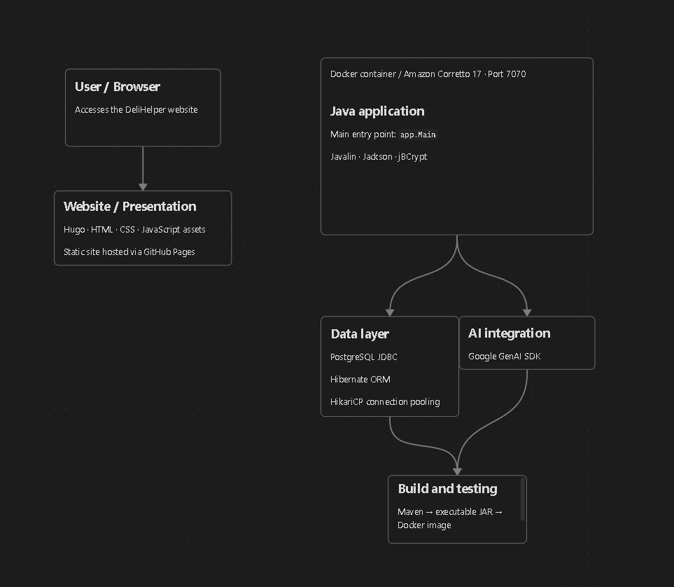
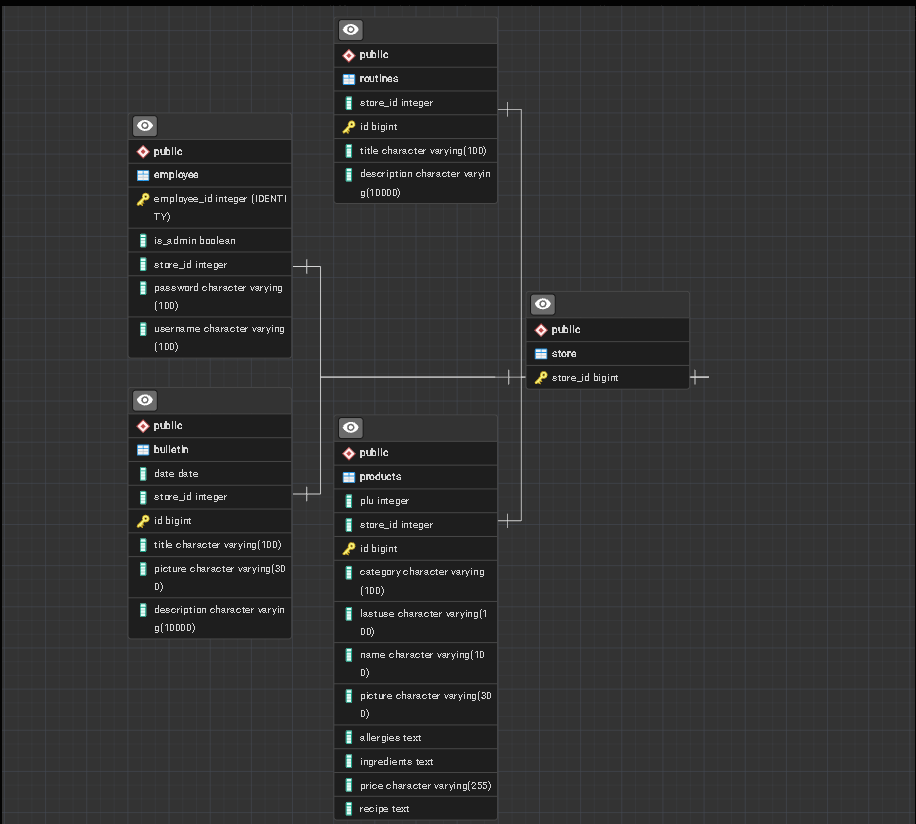

# DeliHelper

## Vision

This Application is meant to be a easy and manageable place to hold recipes, important information and Routines for a 
Resturant / Deli, so that the Employees have an easier time knowing what to do. it also uses Gemeni to Check Products 
for Allergies.

## Links

Deployed application (optional):  
DeliHelper.krammegruppe.dk

Source code repository:  
https://github.com/AlexSmed/DeliHelper

Portfolio website:  
https://alexsmed.github.io/DeliHelper/

---

# Architecture

## System Overview

Its build up so that a Store / Resturant have a id, and that "store_id" is the connection between Products, Employees, 
Routines and a Bulletin board. 

The Products is also categorized so its easier to find a specific type of product.
and (WIP) the bulletin board shows the newsest item first. when you're in the main menu.

#### This project is built as a layered backend architecture using:

- Controller layer (REST endpoints)
- Service layer (business logic)
- Repository layer (database access)


Technologies used:

- Java
- Javalin
- JPA / Hibernate
- PostgreSQL
- Maven
- JWT authentication

---

## Architecture Diagram




## Key Design Decisions

Describe important technical decisions you made.

Examples:

- Why you chose your project structure
- How authentication works
- How errors are handled
- Why you chose specific libraries or frameworks

Example:

**Authentication**

Authentication is implemented using JWT tokens.  
Users log in and receive a token which must be included in subsequent API requests.

---

# Data Model

## ERD



---

## Important Entities

#### Products
 it creates the different Products by name, recipe, ingredients, allergies, categories
- id
- name
- recipe
- allergies
- ingredients
- category
- picture
- store_id
- lastuse
- plu

#### Routines
 its just a big document that should hold Routines from different stores
- id
- title
- description
- store_id

#### Bulletin
- id
- title
- description
- store_id
- picture
- date

#### Employee
- employee_id
- username
- password
- store_id
- is_admin

#### Store
- store_id

---

# API Documentation

Describe the most important endpoints.

## Example Endpoints

### Create Product

POST /api/products


Request body:
{
"name": "Coleslaw",
"ingredients": "1 kg Gulerød Strimler\n1 kg Spidskål\n900 g Mayonaise\n100 g HvidvinsEddike\n100 g Floursukker",
"store_id": "8830",
"category": "Salat",
"allergies": "Egg",
"price": "19 kr pr 100 g",
"recipe": "Mix alt sammen i en container",
"lastUse": "+2 dage",
"plu": "1010"
}


Response:
201 Created


---

### Get all Products
GET /api/products


Response:
{         
"name": "Coleslaw",         
"ingredients": "1 kg Gulerød Strimler 1 kg Spidskål 900 g Mayonaise 100 g HvidvinsEddike 100 g Floursukker",          
"store_id": "8830",                                                                                             
"category": "Salat",            
"allergies": "Egg",          
"price": "19 kr pr 100 g",          
"recipe": "Mix alt sammen i en container",           
"lastUse": "+2 dage",         
"plu": "1010"          
}


---

# User Stories

User Story : 1
Som Admin skal jeg kunne oprette en nye opskrift og produkter         
Acceptance Criteria : Når det virker

User Story : 2
Som admin skal jeg kunne rediger eksisterne opskrifter og produkter        
Acceptance Criteria : Når det virker

User Story : 3
Som admin skal jeg kunne tilføje nu brugere ind i systemet         
Acceptance Criteria : Når det virker

User Story : 4
Som admin skal jeg kunne oprette rutiner og opslag         
Acceptance Criteria : Når det virker       

User Story : 5
Som brugere skal jeg kunne finde opskrifter og produkter, ved at søg på navn eller katogori       
Acceptance Criteria : Når det virker

User Story : 6
Som brugere vil jeg kunne tage et billede af et label fra et produkt  se mulige allegener          
Acceptance Criteria : Når det virker

---

# Development Notes

### Gemini Api Allergi Checker :
while trying to come up with a list that contains allergies to gemini, i had to find allergies. 
i can remove the specific allergies, so it just checks all allergies but i believe it would just take all allergies and make it hard to read.   
Here is the Text Prompt to gemini :   
```
`"You are an expert allergy safety assistant. " +`  
`"Analyze the provided image or text of food ingredients. " +`  
`"Check specifically for these allergens: PEANUTS, GLUTEN, DAIRY, SHELLFISH. " +`  
`"Return your answer strictly as JSON with these fields: " +`  
`"\"containsAllergen\" (boolean), " +`  
`"\"foundAllergens\" (array of strings), " +`  
`"\"reason\" (short explanation)."`
```

(Optional section)

Here you can briefly describe important challenges or lessons learned during development.

Examples:

- Handling authentication with JWT
- Designing the database schema
- Structuring the service layer
- Testing the API